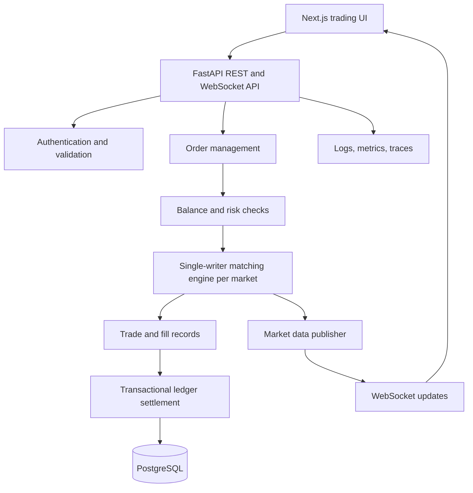

# Apex Exchange — Simulated Digital Asset Exchange

> **Status: In progress — architecture and delivery plan published; implementation is underway.**

Apex Exchange is a portfolio project for exploring the backend and reliability engineering behind a centralized exchange. The initial version is a **simulation only**: users trade test balances against synthetic or explicitly labeled sample market data.

The engineering focus is the order lifecycle, deterministic matching, balance reservations, ledger correctness, concurrency, real-time market data, and recovery testing.

**Repository:** https://github.com/mrchandrabhan/Apex-exchange  
**Portfolio:** https://mrchandrabhan.github.io/

## Project goals

- Accept and validate buy/sell orders for a small set of simulated markets.
- Match limit orders using price-time priority.
- Support partial fills and cancellation.
- Maintain consistent simulated balances with an auditable double-entry ledger.
- Publish order-book and trade updates to clients.
- Test concurrent requests, duplicate submissions, and process restarts.

## Important scope and safety

This is **not** a real exchange. It does not support real-money deposits, withdrawals, custody, wallet keys, blockchain transactions, or live execution. All balances are simulated and must be visibly labeled as test funds. Do not connect this application to real funds or treat it as financial infrastructure.

## Current status

The repository currently contains the project definition, initial architecture, and roadmap. Items below are **planned** unless a future commit and test evidence demonstrate otherwise.

| Capability | Status |
|---|---|
| Repository baseline and architecture | Published |
| API and database scaffold | Planned |
| Simulated users and balances | Planned |
| Limit order validation and lifecycle | Planned |
| Price-time priority matching | Planned |
| Partial fills and cancellation | Planned |
| Double-entry ledger and balance reservations | Planned |
| WebSocket market updates | Planned |
| Concurrency and idempotency tests | Planned |
| Metrics, load tests, and recovery drills | Planned |
| Containerized deployment and CI | Planned |

## Proposed architecture

The MVP begins as a modular backend with a single-writer matching loop per market. This avoids premature distributed matching and provides a clear ordering model. Persistent ledger operations and order state are committed transactionally.



See [docs/architecture.md](docs/architecture.md) for invariants and order lifecycle details.

## Planned technology

| Area | Initial choice | Purpose |
|---|---|---|
| Frontend | Next.js, TypeScript | Trading UI and account views |
| API | Python, FastAPI | Initial modular backend |
| Matching engine | Python for MVP; Go rewrite/benchmark as a later milestone | Deterministic order matching |
| Database | PostgreSQL | Orders, trades, accounts, ledger |
| Real-time | WebSockets | Order-book and trade events |
| Numeric safety | Decimal/fixed-point representation | Avoid binary floating-point money math |
| Tests | pytest | Matching, API, concurrency, and ledger invariants |
| Local environment | Docker Compose | Reproducible development |
| Delivery | GitHub Actions | Lint, test, and build automation |

Redis, Kafka, Kubernetes, Terraform, and a Go matching engine are potential later enhancements, not part of the first working slice.

## Core domain rules

- **Price-time priority:** better price ranks first; equal-price orders are served by arrival sequence.
- **No negative available balances:** funds are reserved before an order can rest or execute.
- **Partial fills:** an order may execute in multiple trades until filled or canceled.
- **Idempotency:** retrying the same client request must not create duplicate orders or ledger postings.
- **Ledger integrity:** each posting group balances; account balances are derived/reconciled against ledger entries.
- **Deterministic matching:** a market's matching loop processes commands in a defined sequence.
- **Atomic settlement:** fills, reservations, and ledger updates must use explicit transaction boundaries and recovery rules.

## MVP scope

1. Seed demo accounts and test balances.
2. Submit and cancel limit orders.
3. Match crossing orders using price-time priority.
4. Support partial fills and trade history.
5. Reserve and settle test balances through a double-entry ledger.
6. Expose order book snapshots and trade events.
7. Stream updates to the frontend through WebSockets.
8. Test correctness under duplicate and concurrent submissions.

Market orders should be added only after price validation, balance reservation, and matching semantics are tested.

## Development roadmap

See [docs/roadmap.md](docs/roadmap.md). The first milestone is a correct matching-engine library with deterministic tests, followed by transactional account and order APIs.

## Day 1 scaffold — run locally

### Prerequisites
- Docker Desktop with the Linux container engine running.
- Git.

### Start the complete stack

```powershell
docker compose up --build
```

Open:
- Web application: http://localhost:3001
- API documentation: http://localhost:8100/docs
- API liveness: http://localhost:8100/health
- API/database readiness: http://localhost:8100/ready
- Synthetic market fixture: http://localhost:8100/api/v1/markets

PostgreSQL is exposed on host port `5434`. The API serves clearly labeled synthetic reference market fixtures only. The current UI is a dashboard scaffold; order entry, matching, wallet balances, ledger settlement, and WebSocket updates are not implemented yet.

### Run backend tests

```powershell
docker compose exec backend pytest -q
```

### Stop the stack

```powershell
docker compose down
```

To remove the local database volume as well (destructive): `docker compose down -v`.

### Useful commands

```powershell
docker compose ps
docker compose logs -f backend
docker compose logs -f frontend
docker compose logs -f db
```

All prices and balances in the MVP are synthetic/test data. This project has no real deposits, withdrawals, custody, keys, blockchain transactions, or live trading.

## Engineering focus

- Use decimal or integer-scaled arithmetic; never binary floating point for prices, quantities, or balances.
- Define invariants before optimizing throughput.
- Keep matching deterministic and isolate market state.
- Persist state transitions and provide a recovery/reconciliation strategy.
- Measure throughput and p50/p95/p99 latency only with a documented test workload.
- Simulate failures; do not claim production-grade availability from a local demo.

## License

No license has been selected yet. Until one is added, normal copyright restrictions apply.
